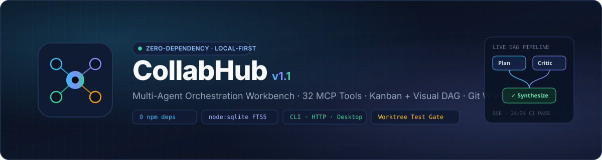
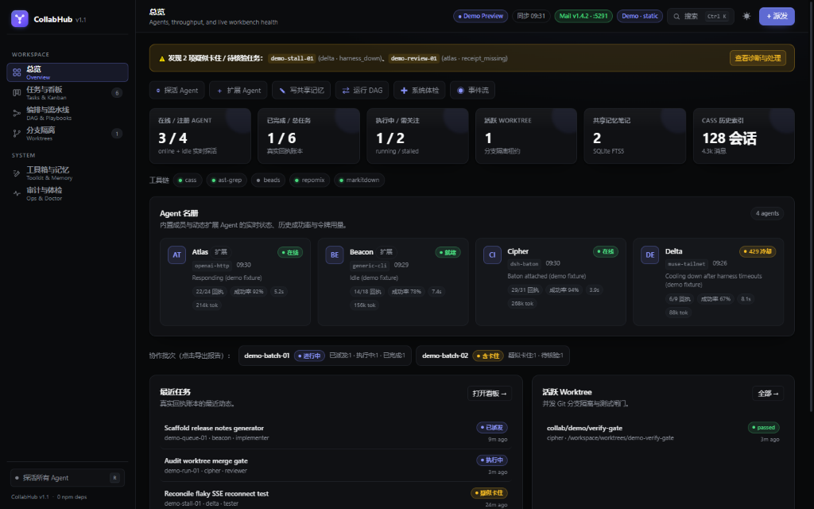
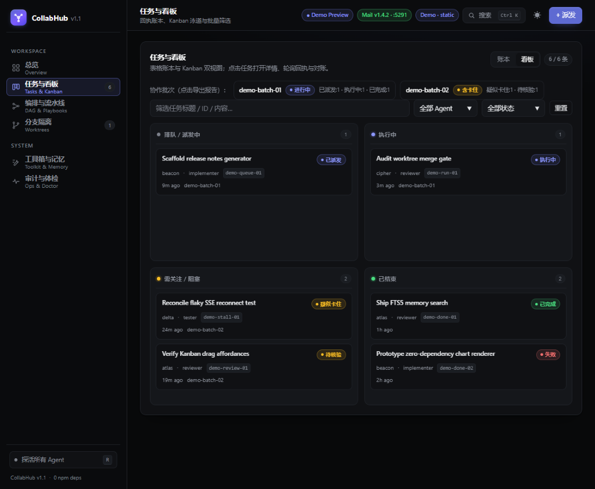
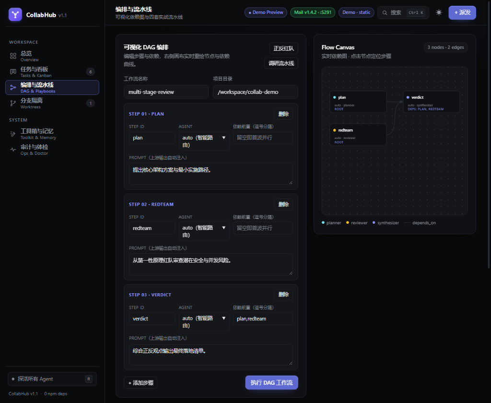
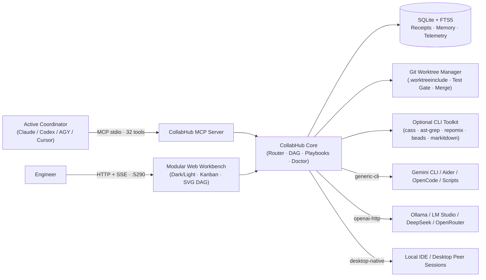

<div align="center">



<h3>Coordinate every AI coding agent you already use — in one local-first MCP hub with real receipt ledgers, Git worktree verification gates, and visual DAGs.</h3>

<p>
  <a href="https://github.com/mortal7520/collab-hub/actions/workflows/ci.yml"></a>
  <a href="https://github.com/mortal7520/collab-hub/releases/latest"></a>
  <a href="https://github.com/mortal7520/collab-hub/stargazers"></a>
  <a href="LICENSE"></a>
  =22.13" />
  
  
</p>

<p>
  <strong>English</strong> · <a href="README.zh-CN.md">简体中文</a> · <a href="CHANGELOG.md">Changelog</a> · <a href="CONTRIBUTING.md">Contributing</a>
</p>

</div>

---

- **Zero lock-in, bring your own agents** — Orchestrate Claude Code, Codex, Gemini CLI, Aider, OpenCode, Ollama, LM Studio, DeepSeek, OpenRouter, or custom scripts behind **32 unified MCP tools** and one local web workbench.
- **No blind merges, no lost runs** — Every dispatch writes a SQLite receipt ledger with token/latency telemetry, stall detection, per-channel 429 cooldowns, and isolated Git worktrees gated by allowlisted test verification before merge.
- **Zero npm dependencies, runs in 10 seconds** — Built purely on Node.js `>=22.13` built-ins (`node:sqlite`, `node:http`, `node:child_process`) across Windows, macOS, and Linux.

<p align="center">
  
</p>

---

## Quick Start

### 1. Launch the Workbench in 10 Seconds (Zero `npm install`)

Requires **Node.js `>=22.13.0`** (uses built-in `node:sqlite`) and `git`.

```bash
git clone https://github.com/mortal7520/collab-hub.git
cd collab-hub
npm start
```

- **Instant safe preview (zero personal data, in-memory fixture)**: open `http://127.0.0.1:5290/?demo=1`
- **Your live local workbench**: open `http://127.0.0.1:5290`
- Press `Ctrl+K` / `Cmd+K` anywhere in the UI for the Command Palette, or click the theme icon to toggle **Obsidian Dark** / **Alabaster Light**.

### 2. Connect Your MCP Client

Add CollabHub to Claude Code, Codex, Antigravity, Cursor, or any MCP-compatible host:

```json
{
  "mcpServers": {
    "collab-hub": {
      "command": "node",
      "args": ["/absolute/path/to/collab-hub/bin/collab-hub.mjs", "mcp"]
    }
  }
}
```

### 3. Discover Installed Agents & Verify Locally

```bash
# Auto-detect installed local coding CLIs & OpenAI-compatible endpoints (Ollama, LM Studio, etc.)
node bin/collab-hub.mjs discover

# Run the full automated test suite (26 tests, zero external deps)
npm test
```

---

## Visual Walkthrough

### Dual Table + 4-Column Kanban & Batch Receipts
Track every delegated task across `Queued`, `Running`, `Needs Attention / Stalled`, and `Done` lanes. Filter by agent, status, or batch, inspect full delivery receipts, and export formatted Markdown batch reports in one click.

<p align="center">
  
</p>

### Interactive SVG DAG Builder & One-Click Playbooks
Compose multi-stage workflows where downstream stages automatically inherit upstream outputs, detect cycles visually on the interactive SVG `Flow Canvas`, or launch 4 battle-tested Playbooks (`code-review-squad`, `research-and-pack`, `adversarial-debate`, `multi-agent-build`).

<p align="center">
  
</p>

---

## Architecture



---

## Honest Comparison

How CollabHub compares with popular open-source coding-agent orchestrators:

| Capability | **CollabHub** | **Vibe Kanban** | **Cline** | **Overstory** *(archived)* | **OpenHands** |
| :--- | :---: | :---: | :---: | :---: | :---: |
| **Primary form factor** | Local MCP hub + Web Workbench | Kanban web app | IDE extension | CLI orchestrator + `ov serve` UI | Full autonomous cloud/Docker platform |
| **Multi-agent heterogeneous routing** | Built-in (`auto` + fallback + 429 cooldown) | Multiple agents per card | Single IDE loop | Multi-agent CLI swarm | Multi-agent SDK / runtime |
| **Visual SVG DAG + Playbooks** | Built-in | Kanban cards | Workflows / hooks | Sling / mail waves | SDK pipelines |
| **Git worktree + test-gated merge** | Built-in (`verify` SHA gate + `.worktreeinclude`) | Built-in worktrees | Workspace edits | Built-in worktrees | Containerized sandboxes |
| **Zero npm runtime dependencies** | **Yes** (`node:sqlite` + built-ins) | No (Rust/Node stack) | No (VS Code ext) | No (Bun/TS stack) | No (Python + Docker) |
| **Hosted SaaS / Cloud sandboxes** | **No** (strictly local-first) | Optional | BYO API / cloud | No | **Yes** |

> **When *not* to choose CollabHub:** If you want a hosted cloud team SaaS, containerized remote execution sandboxes, or an embedded single-editor autocomplete sidebar, tools like **OpenHands**, **Cline**, or **Vibe Kanban** may fit better. CollabHub is intentionally built for engineers who already run multiple local coding agents/CLIs and want a lightweight, auditable, zero-dependency control plane that respects their existing accounts, permissions, and local Git workflow.

---

## Pluggable Agent Adapters

Register any additional agent dynamically via the UI (`+ Expand Agent`) or `collab_agent_register` — persisted in `<dataDir>/agents.json`:

| Adapter Type | Examples | Security Model |
| :--- | :--- | :--- |
| `generic-cli` | Gemini CLI, Aider, OpenCode, Qwen Code, custom shell/Python scripts | Executed via argv array (`shell: false`), strict timeout, output captured to receipt ledger |
| `openai-http` | Ollama (`localhost:11434/v1`), LM Studio, vLLM, DeepSeek, OpenRouter | **`api_key_env` only** — CollabHub never stores or logs plaintext API keys |
| `desktop-native` | Active IDE / Desktop agent conversations | Coordinator-attested handoff ledger; never silently spoofs or replaces a Desktop session with CLI |

Optional local integrations (such as custom bridges or [mcp_agent_mail_rust](https://github.com/Dicklesworthstone/mcp_agent_mail_rust) for advisory file leases) can be configured outside Git via `<dataDir>/integrations.json` or environment variables.

---

## MCP Tool Reference (32 Tools)

<details>
<summary><strong>Click to expand all 32 unified MCP tools</strong></summary>

| Category | Tools |
| :--- | :--- |
| **Fleet & Routing** | `collab_roster`, `collab_plan`, `collab_metrics`, `collab_cooldown` |
| **Dynamic Agent Registry** | `collab_agent_discover`, `collab_agent_register`, `collab_agent_list`, `collab_agent_remove` |
| **Dispatch & Receipt Ledger** | `collab_dispatch`, `collab_poll`, `collab_poll_batch`, `collab_task_reconcile`, `collab_record_handoff`, `collab_tasks`, `collab_batch_report` |
| **DAGs, Playbooks & Recipes** | `collab_workflow_run`, `collab_playbook_run`, `collab_recipes` |
| **Git Worktree Isolation & Gates** | `collab_worktree_create`, `collab_worktree_review`, `collab_worktree_verify`, `collab_worktree_merge`, `collab_worktree_cleanup` |
| **Shared FTS5 Memory** | `collab_memory_write`, `collab_memory_search`, `collab_memory_list` |
| **Optional Open-Source Toolkit** | `collab_session_search` (`cass`), `collab_ast_search` (`ast-grep`), `collab_repo_pack` (`repomix`), `collab_beads` (`bd`), `collab_doc_to_md` (`markitdown`) |
| **Ops & Diagnostics** | `collab_doctor` (8-point health check + SQLite `VACUUM INTO` hot backups) |

</details>

---

## Configuration & Storage

By default, CollabHub stores all runtime data inside the OS standard user directory (`~/.collab-hub` on macOS/Linux, `%LOCALAPPDATA%\CollabHub` on Windows) — never inside your Git repository.

| Environment Variable | Default | Purpose |
| :--- | :--- | :--- |
| `COLLAB_HUB_HOME` | `~/.collab-hub` / `%LOCALAPPDATA%\CollabHub` | Override runtime root (`data/`, `backups/`, `logs/`, `worktrees/`) |
| `COLLAB_HUB_WORKSPACE` | Current directory | Default workspace root for worktrees and project autocomplete |
| `COLLAB_HUB_PORT` | `5290` | Web Workbench HTTP + SSE port (bound strictly to `127.0.0.1`) |
| `COLLAB_HUB_MAIL_PORT` | `5291` | Optional Agent Mail port for advisory file leases |

You may also place a gitignored `.collab-hub.local.json` file in the repository root to pin `appRoot` or `workspaceRoot` locally without touching tracked files.

---

## Security & Hardening

- **Loopback-only binding**: HTTP/SSE server binds strictly to `127.0.0.1`.
- **Hardened static serving & CSP**: `public/` assets are served through a flat exact-filename allowlist with strict `Content-Security-Policy` (`default-src 'self'; script-src 'self'; style-src 'self'; img-src 'self' data:; base-uri 'none'; object-src 'none'; frame-ancestors 'none'`).
- **SHA-pinned worktree verification gate**: `collab_worktree_verify` executes allowlisted test commands and records the tested commit SHA; `collab_worktree_merge` blocks merges if verification failed or if new unverified commits landed since verification.
- **Zero plaintext secrets**: `openai-http` agents accept environment variable names (`api_key_env`) only; `?demo=1` preview reads zero database/disk state (verified by automated canary isolation tests).

---

## Dogfooding: Built with CollabHub

`v1.1.0` was orchestrated using CollabHub itself (`batch_id: v11_release_team`):
1. **Frontend Redesign** — Delegated to an autonomous coding worker inside an isolated Git worktree (`wt_v11_ui`), automatically reviewed with `collab_worktree_review`, gated with `collab_worktree_verify`, and merged via `collab_worktree_merge`.
2. **Adversarial Security & Release Audit** — Cross-checked in parallel by an independent reviewer agent, surfacing CSP hardening, `HEAD` body handling, `?demo=1` DB canary isolation, and worktree verification-gate guards.
3. **Open-Source Positioning Review** — Reviewed by a research agent to streamline Quick Start, tighten benchmark honesty, and craft the 3-frame visual showcase.

---

## License

MIT — see [LICENSE](LICENSE).
