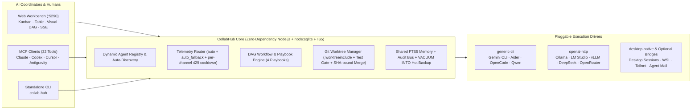

# CollabHub

[](https://github.com/mortal7520/collab-hub/actions/workflows/ci.yml)
[](./LICENSE)
[](https://nodejs.org)
[](#architecture)

**Zero-dependency, local-first multi-agent orchestration workbench** — unify CLI agents, local/cloud OpenAI-compatible models, and Desktop AI assistants under one auditable SQLite ledger, **32 MCP tools**, dual **Table + Kanban** web cockpit, visual multi-stage **DAG workflow builder**, and isolated **Git worktrees with closed-loop test verification gates**.

[简体中文文档 (Chinese README)](./README.zh-CN.md) · [Security Policy](./SECURITY.md) · [Contributing](./CONTRIBUTING.md) · [Changelog](./CHANGELOG.md)

---

## Why CollabHub? (Competitive Comparison)

| Capability | CollabHub `v1.0` | Vibe Kanban | Claude Squad | Overstory |
| --- | :---: | :---: | :---: | :---: |
| **Zero npm runtime dependencies (pure Node + native `node:sqlite`)** | ✅ | ❌ | ❌ (Go/tmux) | ❌ |
| **Dual Table + 4-Column Kanban UI + Live SSE Push** | ✅ | ✅ (Kanban) | ❌ (TUI) | ❌ (CLI) |
| **Unified MCP Server (32 tools for Claude / Codex / Antigravity / Cursor)** | ✅ | Partial | ❌ | Partial |
| **Pluggable Agents (`generic-cli` + `openai-http` + `desktop-native`)** | ✅ | CLI | CLI | CLI |
| **Auto-Discovery (Ollama / LM Studio / vLLM / PATH CLIs / env keys)** | ✅ | ❌ | ❌ | ❌ |
| **Visual Multi-Stage DAG Workflow Builder + Upstream Context Injection** | ✅ | ❌ | ❌ | ✅ |
| **Git Worktree Isolation + `.worktreeinclude` Sync + Test Verify Gate** | ✅ | ✅ | ✅ | ✅ |
| **Telemetry-Aware Smart Routing (`auto` + pre-dispatch `auto_fallback`)** | ✅ | ❌ | ❌ | ❌ |
| **Shared FTS5 + Markdown Memory + Batch Markdown Report Export** | ✅ | ❌ | ❌ | Mail |
| **Defense-in-Depth (Host `421`, CSRF `403`, SHA-bound Merge, Zero Plaintext Keys)** | ✅ | Partial | N/A | Partial |

---

## Architecture



---

## Quick Start (30 Seconds)

**Prerequisites**: Node.js `>= 22.13.0` (uses built-in `node:sqlite` and `node:test`) and `git`.

```bash
git clone https://github.com/mortal7520/collab-hub.git
cd collab-hub

# 1. Verify everything passes locally (zero npm install needed!)
npm test

# 2. Launch the interactive Web Workbench at http://127.0.0.1:5290
npm start
```

Open **http://127.0.0.1:5290** in your browser to:
- Switch between **📋 Ledger Table** and **🗂️ 4-Column Kanban Board** views.
- Click **+ 扩展 Agent → 🔍 扫描本机 Ollama / CLI / 环境变量** to auto-discover running local models & CLIs.
- Click **🔀 DAG 编排** to compose multi-stage parallel workflows (`advocate` + `redteam` → `verdict`).
- Click **▶ Playbook** to run `code-review-squad`, `research-and-pack`, `adversarial-debate`, or `multi-agent-build`.
- Click **🩺 体检** for an 8-point integrity check and one-click `VACUUM INTO` hot SQLite backup.

---

## Connect to MCP Clients (32 Unified Tools)

Register `collab-hub` as a stdio MCP server in Claude Code, Codex, Cursor, or Antigravity:

```json
{
  "mcpServers": {
    "collab-hub": {
      "command": "node",
      "args": ["/path/to/collab-hub/src/mcp-server.mjs"],
      "env": {
        "COLLAB_HUB_WORKSPACE_ROOT": "/path/to/your/workspace"
      }
    }
  }
}
```

### Key MCP Tool Groups (32 Tools)
- **Agent Registry & Discovery (4)**: `collab_agent_discover`, `collab_agent_register`, `collab_agent_list`, `collab_agent_remove`
- **Live Health, Telemetry & Cooldowns (4)**: `collab_roster`, `collab_plan`, `collab_cooldown`, `collab_metrics`
- **Tasks, Smart Routing, DAGs & Recipes (9)**: `collab_dispatch` (supports `member="auto"` + pre-dispatch `auto_fallback`), `collab_poll`, `collab_poll_batch`, `collab_task_reconcile`, `collab_tasks`, `collab_record_handoff`, `collab_workflow_run`, `collab_batch_report`, `collab_recipes`
- **Git Worktree Isolation & Verification Gate (5)**: `collab_worktree_create` (auto-syncs `.worktreeinclude`), `collab_worktree_review` (binds `reviewed_head_sha`), `collab_worktree_verify` (allowlisted test preset gate), `collab_worktree_merge` (requires `confirmed: true`), `collab_worktree_cleanup`
- **Shared FTS5 + Markdown Memory (3)**: `collab_memory_write`, `collab_memory_search`, `collab_memory_list`
- **Engineering Toolkit, Playbooks & System Doctor (7)**: `collab_session_search`, `collab_repo_pack`, `collab_ast_search`, `collab_beads`, `collab_doc_to_md`, `collab_playbook_run`, `collab_doctor`

---

## Extending with Any Agent

### 1. Local OpenAI-Compatible Models (Ollama / LM Studio / vLLM)
```bash
node bin/collab-hub.mjs agent add ollama-qwen "Ollama Qwen2.5 Coder" openai-http \
  --roles researcher,reviewer,synthesizer \
  --config '{"base_url":"http://127.0.0.1:11434/v1","model":"qwen2.5-coder:14b","api_key_env":""}'
```

### 2. Cloud OpenAI-Compatible APIs (Zero Plaintext Keys!)
CollabHub **rejects plaintext `api_key` values** and reads credentials strictly from `api_key_env`:
```bash
node bin/collab-hub.mjs agent add deepseek-r1 "DeepSeek Reasoner" openai-http \
  --roles planner,reviewer,synthesizer \
  --config '{"base_url":"https://api.deepseek.com/v1","model":"deepseek-reasoner","api_key_env":"DEEPSEEK_API_KEY"}'
```

### 3. Any CLI Agent (`generic-cli`)
```bash
node bin/collab-hub.mjs agent add gemini-cli "Gemini CLI" generic-cli \
  --roles researcher,reviewer \
  --config '{"command":"gemini","args":["-p","{{prompt}}"],"prompt_mode":"arg","timeout_s":120}'
```

---

## Configuration & Portability

By default, CollabHub stores runtime data in `~/.collab-hub` and scopes workspace operations to `process.cwd()`. Customize via environment variables or a gitignored `.collab-hub.local.json`:

| Env Variable | Default | Description |
| --- | --- | --- |
| `COLLAB_HUB_APP_ROOT` | `~/.collab-hub` | Runtime directory (`data/`, `worktrees/`, `backups/`, `logs/`) |
| `COLLAB_HUB_WORKSPACE_ROOT` | `process.cwd()` | Primary allowed workspace root for path-jailed operations |
| `COLLAB_HUB_PORT` | `5290` | Loopback Web Workbench port (`127.0.0.1`) |
| `COLLAB_HUB_MAIL_PORT` | `5291` | Optional `mcp_agent_mail_rust` companion port |

---

## Optional Ecosystem Integrations

CollabHub gracefully integrates with these upstream open-source tools when installed in `<APP_ROOT>/bin` or `<APP_ROOT>/tools`:
- [`Dicklesworthstone/mcp_agent_mail_rust`](https://github.com/Dicklesworthstone/mcp_agent_mail_rust) — Advisory file reservations & cross-agent mail threads
- [`Dicklesworthstone/coding_agent_session_search`](https://github.com/Dicklesworthstone/coding_agent_session_search) (`cass`) — Read-only cross-client session history search
- [`ast-grep/ast-grep`](https://github.com/ast-grep/ast-grep) — Structural AST code search
- [`yamadashy/repomix`](https://github.com/yamadashy/repomix) — Bounded repository context packing
- [`microsoft/markitdown`](https://github.com/microsoft/markitdown) — Local PDF/Office/HTML to Markdown conversion
- [`steveyegge/beads`](https://github.com/steveyegge/beads) — Git-native issue & epic dependency graphs

---

## License

[MIT](./LICENSE) © 2026 Mortal
