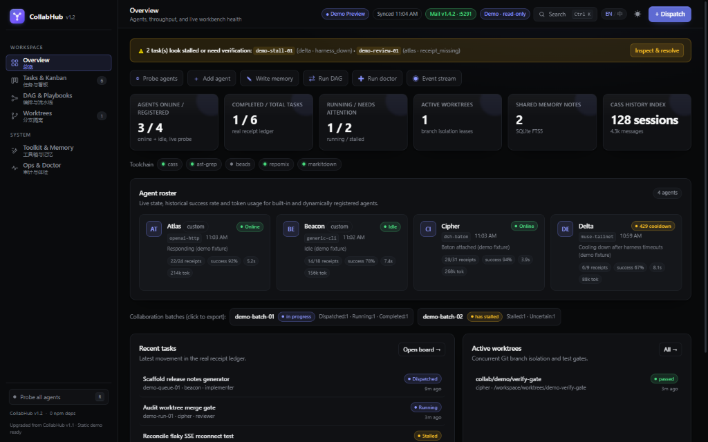
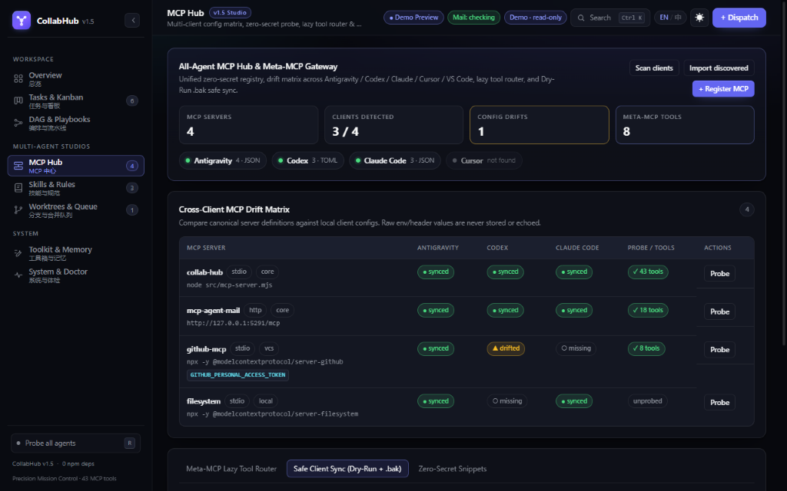
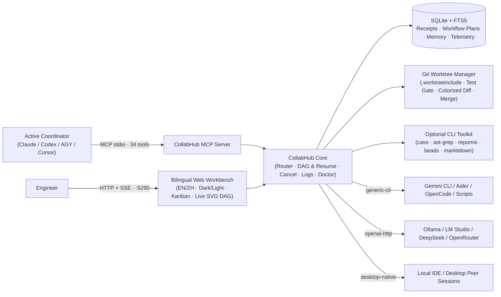

<div align="center">


<h3>Coordinate every AI coding agent you already use — in one local-first MCP hub with live streaming logs, live SVG DAGs, checkpoint resume, Git worktree gates, and zero npm dependencies.</h3>

<p>
  <a href="https://mortal7520.github.io/collab-hub/"></a>
</p>

<p>
  <a href="https://github.com/mortal7520/collab-hub/actions/workflows/ci.yml"></a>
  <a href="https://github.com/mortal7520/collab-hub/releases/latest"></a>
  <a href="https://github.com/mortal7520/collab-hub/stargazers"></a>
  <a href="LICENSE"></a>
  =22.13" />
  
  
</p>

<p>
  <strong>English</strong> · <a href="README.zh-CN.md">简体中文</a> · <a href="https://mortal7520.github.io/collab-hub/">Live Demo</a> · <a href="docs/UPSTREAM-REUSE.md">Upstream Reuse</a> · <a href="CHANGELOG.md">Changelog</a> · <a href="CONTRIBUTING.md">Contributing</a>
</p>

</div>

---

> **No browser required — Host-Native Cockpits Everywhere (`v2.0`):**
> - **Antigravity (AGY) · Claude Desktop · Codex Desktop**: Call `collab_cockpit` (or open **CollabHub** from Antigravity's left sidebar / `+` side pane) to launch our **60fps SEP-1865 MCP App Neural Cockpit** (`ui://collab-hub/cockpit.html`) right inside your IDE/chat!
> - **Claude Code CLI · Codex CLI · WSL DSH Terminal**: Run `node bin/collab-hub.mjs tui` for a **24-bit TrueColor animated terminal cockpit**, or wire `node bin/collab-hub.mjs hud --format statusline` into Claude Code's bottom `statusLine` (<10ms SQLite read)!
> - **Browser Interactive Demo (zero install)**: [**Open Live Workbench Demo →**](https://mortal7520.github.io/collab-hub/)

- **Host-Native 60fps SEP-1865 MCP App Cockpit (`v2.0`)** — Self-contained `ui://collab-hub/cockpit.html` (`text/html;profile=mcp-app`) with a 60fps Canvas Neural Fleet Constellation, 5 interactive tabs (Radar / Kanban & Logs / MCP Hub / Skills & Rules / Merge Queue), bidirectional `tools/call` + `ui/message` + `com.google.antigravity/toggle-aux-pane`, auto-pausing off-screen animation, and Cyber-HUD Unicode fallback (adapted from `modelcontextprotocol/ext-apps`).
- **24-Bit TrueColor Animated TUI & Sub-100ms StatusLine HUD (`v2.0`)** — Keyboard-first animated terminal cockpit (`collab-hub tui`) and sub-10ms live `statusLine` HUD (`collab-hub hud`) with strict `NO_COLOR`/`TERM=dumb`/TTY degradation and crash-safe terminal restoration (inspired by `asheshgoplani/agent-deck` and `sirmalloc/ccstatusline`).
- **All-Agent MCP Hub & Meta-MCP Lazy Tool Router** — Zero-secret cross-client MCP matrix across Antigravity, Codex, Claude Code, Cursor, Windsurf, and VS Code, live JSON-RPC probing with fail-closed IPv6 SSRF guard, lazy `find_tools` + `call_tool` gateway, and **Dry-Run diff + automatic `.bak` backup** safe sync.
- **Cross-Agent Skills & Rules Sync Center** — Full directory-tree hashing & secret scanning across `SKILL.md` directories and project rules (`AGENTS.md`, `CLAUDE.md`, `GEMINI.md`, `.cursor/rules/*.mdc`, `.windsurfrules`) with atomic temp-dir swaps and `.bak` backups.
- **Worktree Inline Diff Comments & Serialized Merge Queue** — Click any diff line to pin comments and dispatch rework directly into the owning worktree, then run side-effect-free speculative `git merge-tree` conflict checks with atomic queue claims before serially merging into `main`.
- **Zero npm dependencies, 45 MCP tools, 39 end-to-end tests** — Built purely on Node.js `>=22.13` built-ins with full upstream provenance in [docs/UPSTREAM-REUSE.md](docs/UPSTREAM-REUSE.md).

<p align="center">
  <a href="https://mortal7520.github.io/collab-hub/">
    
  </a>
</p>

---

## What You'll See in the Demo

### All-Agent MCP Hub, Meta-MCP Router & Safe Dry-Run `.bak` Sync (`v1.5`)
Compare Antigravity (`JSON`), Codex (`TOML`), Claude Code (`JSON`), Cursor, Windsurf, and VS Code MCP configurations in one drift matrix, search and invoke probed tools lazily through the Meta-MCP gateway, and preview colorized Dry-Run diffs before applying `.bak`-backed syncs.

<p align="center">
  
</p>

### Live SVG DAG Execution Overlay & Checkpoint Resume
Watch multi-stage workflows light up on the interactive `Flow Canvas` (`Completed · 2.2s ✓`, pulsing `Running` ring, dashed dependency curves), save your own reusable DAG templates, or resume failed runs from their last checkpoint without re-running completed upstream stages.

<p align="center">
  
</p>

### Live Streaming Output & Process Cancel/Abort
Click any running task in the Kanban board or DAG canvas to watch stdout/stderr chunks stream in real time over SSE, copy output in one click, or terminate a runaway CLI/HTTP process cleanly via **Cancel** (`collab_cancel`).

<p align="center">
  
</p>

### Dual Table + 4-Column Kanban & Batch Receipts
Track every delegated task across `Queued`, `Running`, `Needs Attention / Stalled`, and `Done` lanes with instant filtering, colorized Worktree unified diffs, and one-click Markdown batch reports.

<p align="center">
  
</p>

---

## Quick Start

### 1. Launch Locally in 10 Seconds (Zero `npm install`)

Requires **Node.js `>=22.13.0`** (uses built-in `node:sqlite`) and `git`.

```bash
git clone https://github.com/mortal7520/collab-hub.git
cd collab-hub
npm start
```

- **Local safe demo preview (zero personal data, in-memory fixture)**: `http://127.0.0.1:5290/?demo=1`
- **Your live local workbench**: `http://127.0.0.1:5290`
- Press `Ctrl+K` / `Cmd+K` for the Command Palette, click `EN / 中` to switch languages, or toggle **Obsidian Dark** / **Alabaster Light**.

### 2. Connect Your MCP Client

Add CollabHub to Claude Code, Codex, Antigravity, Cursor, or any MCP-compatible host:

```json
{
  "mcpServers": {
    "collab-hub": {
      "command": "node",
      "args": ["/absolute/path/to/collab-hub/bin/collab-hub.mjs", "mcp"]
    }
  }
}
```

### 3. Discover Installed Agents & Verify Locally

```bash
# Auto-detect installed local coding CLIs & OpenAI-compatible endpoints (Ollama, LM Studio, etc.)
node bin/collab-hub.mjs discover

# Run the full automated test suite (29 tests, zero external deps)
npm test
```

---

## Architecture



---

## Honest Comparison

How CollabHub compares with popular open-source coding-agent orchestrators:

| Capability | **CollabHub** | **Vibe Kanban** | **Cline** | **Overstory** *(archived)* | **OpenHands** |
| :--- | :---: | :---: | :---: | :---: | :---: |
| **Primary form factor** | Local MCP hub + Web Workbench | Kanban web app | IDE extension | CLI orchestrator + `ov serve` UI | Full autonomous cloud/Docker platform |
| **Multi-agent heterogeneous routing** | Built-in (`auto` + fallback + 429 cooldown) | Multiple agents per card | Single IDE loop | Multi-agent CLI swarm | Multi-agent SDK / runtime |
| **Live SVG DAG + Checkpoint Resume** | **Built-in** (live overlay + `workflow_plans`) | Kanban cards | Workflows / hooks | Sling / mail waves | SDK pipelines |
| **Live streaming logs + Cancel** | **Built-in** (SSE tail + process abort) | Built-in logs | IDE panel | CLI logs | Container logs |
| **Git worktree + test-gated merge** | Built-in (`verify` SHA gate + colorized diff) | Built-in worktrees | Workspace edits | Built-in worktrees | Containerized sandboxes |
| **Zero npm runtime dependencies** | **Yes** (`node:sqlite` + built-ins) | No (Rust/Node stack) | No (VS Code ext) | No (Bun/TS stack) | No (Python + Docker) |
| **Hosted SaaS / Cloud sandboxes** | **No** (strictly local-first) | Optional | BYO API / cloud | No | **Yes** |

> **When *not* to choose CollabHub:** If you want a hosted cloud team SaaS, containerized remote execution sandboxes, or an embedded single-editor autocomplete sidebar, tools like **OpenHands**, **Cline**, or **Vibe Kanban** may fit better. CollabHub is intentionally built for engineers who already run multiple local coding agents/CLIs and want a lightweight, auditable, zero-dependency control plane that respects their existing accounts, permissions, and local Git workflow.

---

## Pluggable Agent Adapters

Register any additional agent dynamically via the UI (`+ Add agent`) or `collab_agent_register` — persisted in `<dataDir>/agents.json`:

| Adapter Type | Examples | Security Model |
| :--- | :--- | :--- |
| `generic-cli` | Gemini CLI, Aider, OpenCode, Qwen Code, custom shell/Python scripts | Executed via argv array (`shell: false`), strict timeout, live log ring buffer & process-tree abort |
| `openai-http` | Ollama (`localhost:11434/v1`), LM Studio, vLLM, DeepSeek, OpenRouter | **`api_key_env` only** — never stores plaintext keys; 2 MiB response cap & `AbortController` cancel |
| `desktop-native` | Active IDE / Desktop agent conversations | Coordinator-attested handoff ledger; never silently spoofs or replaces a Desktop session with CLI |

Optional local integrations (such as custom bridges or [mcp_agent_mail_rust](https://github.com/Dicklesworthstone/mcp_agent_mail_rust) for advisory file leases) can be configured outside Git via `<dataDir>/integrations.json` or environment variables.

---

## MCP Tool Reference (34 Tools)

<details>
<summary><strong>Click to expand all 34 unified MCP tools</strong></summary>

| Category | Tools |
| :--- | :--- |
| **Fleet & Routing** | `collab_roster`, `collab_plan`, `collab_metrics`, `collab_cooldown` |
| **Dynamic Agent Registry** | `collab_agent_discover`, `collab_agent_register`, `collab_agent_list`, `collab_agent_remove` |
| **Dispatch, Cancel & Receipt Ledger** | `collab_dispatch`, `collab_poll`, `collab_poll_batch`, `collab_cancel`, `collab_task_reconcile`, `collab_record_handoff`, `collab_tasks`, `collab_batch_report` |
| **DAGs, Resume, Playbooks & Recipes** | `collab_workflow_run`, `collab_workflow_resume`, `collab_playbook_run`, `collab_recipes` |
| **Git Worktree Isolation & Gates** | `collab_worktree_create`, `collab_worktree_review`, `collab_worktree_verify`, `collab_worktree_merge`, `collab_worktree_cleanup` |
| **Shared FTS5 Memory** | `collab_memory_write`, `collab_memory_search`, `collab_memory_list` |
| **Optional Open-Source Toolkit** | `collab_session_search` (`cass`), `collab_ast_search` (`ast-grep`), `collab_repo_pack` (`repomix`), `collab_beads` (`bd`), `collab_doc_to_md` (`markitdown`) |
| **Ops & Diagnostics** | `collab_doctor` (8-point health check + SQLite `VACUUM INTO` hot backups) |

</details>

---

## Configuration & Storage

By default, CollabHub stores all runtime data inside the OS standard user directory (`~/.collab-hub` on macOS/Linux, `%LOCALAPPDATA%\CollabHub` on Windows) — never inside your Git repository.

| Environment Variable | Default | Purpose |
| :--- | :--- | :--- |
| `COLLAB_HUB_HOME` | `~/.collab-hub` / `%LOCALAPPDATA%\CollabHub` | Override runtime root (`data/`, `backups/`, `logs/`, `worktrees/`) |
| `COLLAB_HUB_WORKSPACE` | Current directory | Default workspace root for worktrees and project autocomplete |
| `COLLAB_HUB_PORT` | `5290` | Web Workbench HTTP + SSE port (bound strictly to `127.0.0.1`) |
| `COLLAB_HUB_MAIL_PORT` | `5291` | Optional Agent Mail port for advisory file leases |

You may also place a gitignored `.collab-hub.local.json` file in the repository root to pin `appRoot` or `workspaceRoot` locally without touching tracked files.

---

## Security & Hardening

- **Loopback-only binding & SSE backpressure guard**: HTTP/SSE server binds strictly to `127.0.0.1` with a 512 KiB per-client SSE backpressure cutoff and 2 MiB HTTP agent response cap.
- **Hardened static serving & CSP**: `public/` assets are served through a flat exact-filename allowlist with strict `Content-Security-Policy`; GitHub Pages builds also inject `<meta http-equiv="Content-Security-Policy">` and skip same-origin `localStorage` templates in demo mode.
- **Confirmed cancellation & safe checkpoint resume**: `collab_cancel` refuses unconfirmed out-of-process cancellations unless `force: true` is explicitly set; `collab_workflow_resume` preserves original `workflow_plans` parameters and never blindly retries `uncertain` or `stalled` tasks.
- **SHA-pinned worktree verification gate**: `collab_worktree_verify` records the tested commit SHA; `collab_worktree_merge` blocks merges if verification failed or new unverified commits landed.

---

## Dogfooding: Built with CollabHub

`v1.2.0` was built and audited concurrently using CollabHub's own 4-agent team (`batch_id: v12_combo_team`):
1. **Frontend Combo (`wt_v12_ui`)** — Built inside an isolated Git worktree, gated by `collab_worktree_verify`, and merged with zero conflicts via `collab_worktree_merge`.
2. **Adversarial P0/P1 Audit** — Independently audited in parallel with live in-memory reproduction, surfacing and fixing 6 edge cases across cross-process cancellation, `workflow_plans` persistence, SSE backpressure, and Pages CSP before tagging.
3. **Launch Positioning & Copy** — Reviewed concurrently to elevate the interactive browser demo above the fold and tighten release notes.

---

## License

MIT — see [LICENSE](LICENSE).
