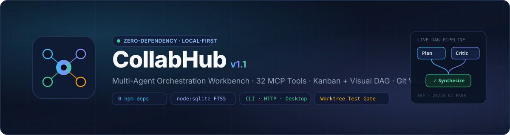
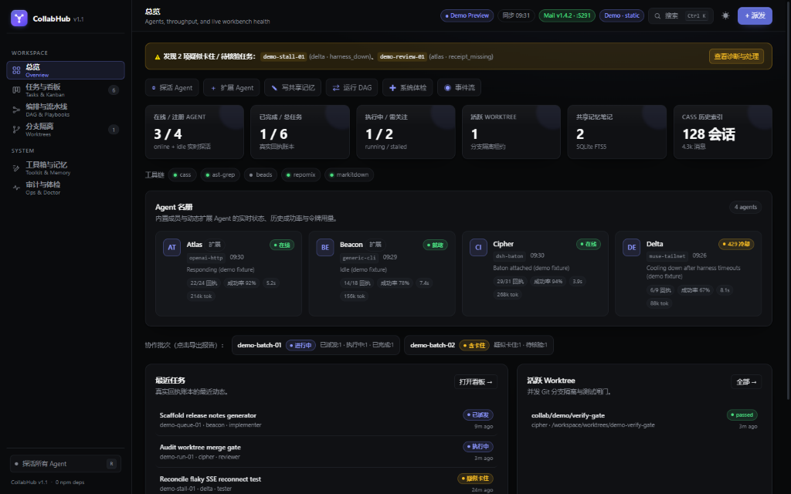
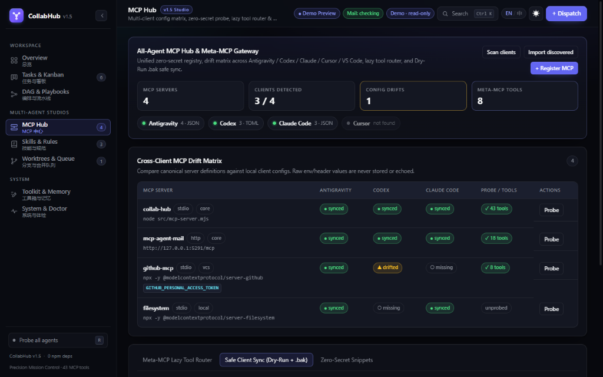
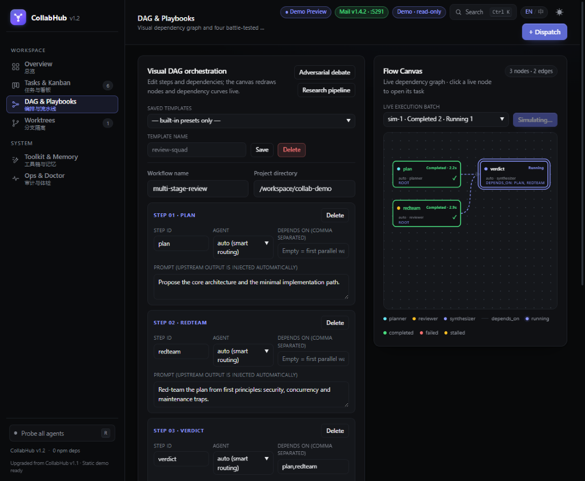
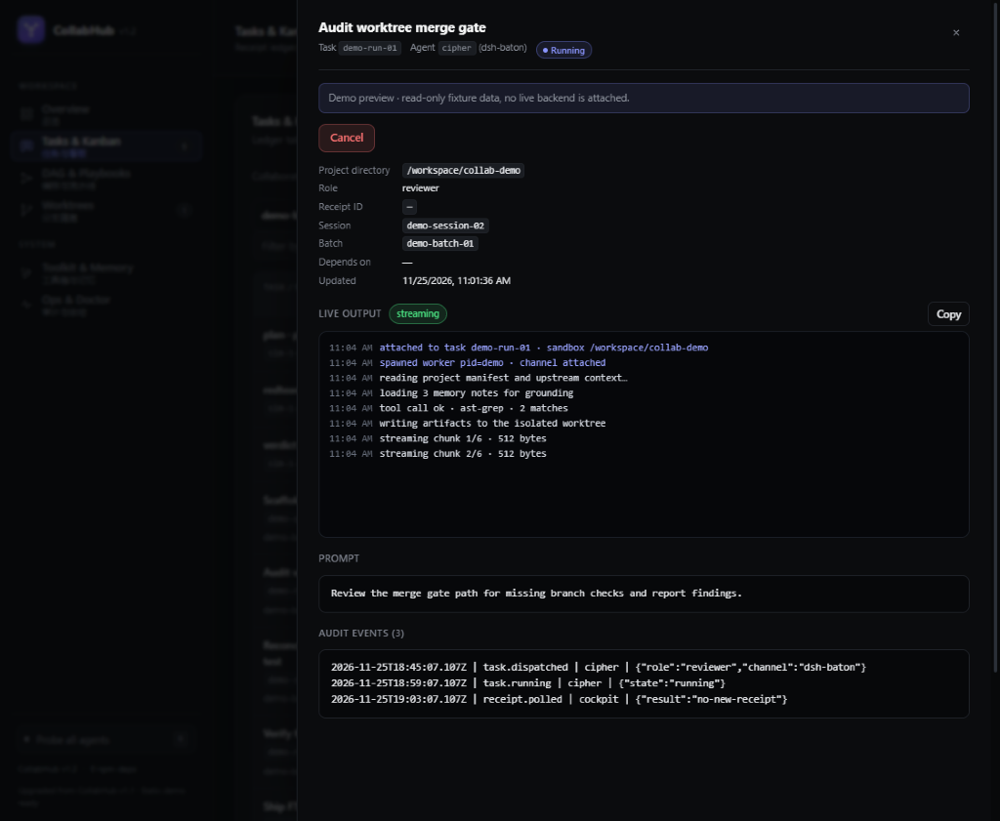
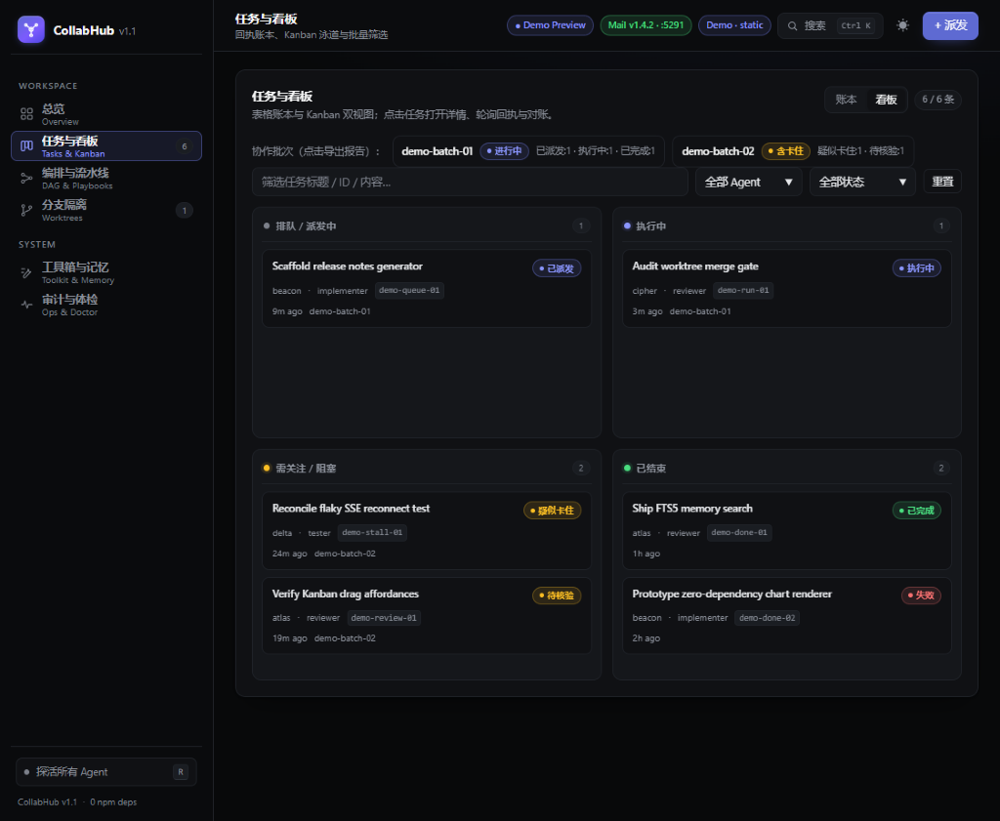
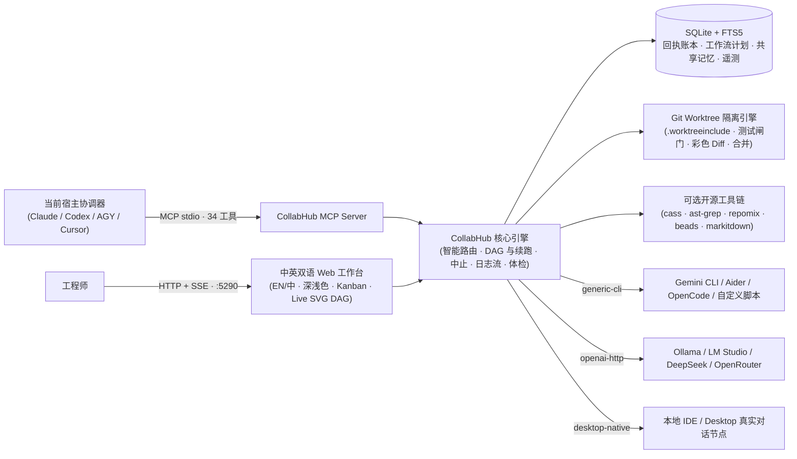

<div align="center">



<h3>把你已在使用的 AI 编程 Agent 统一到一个本地优先的 MCP 协作中枢 —— 实时流式日志、可视化 SVG DAG、断点续跑与 Git Worktree 测试闸门，零 npm 运行时依赖。</h3>

<p>
  <a href="https://mortal7520.github.io/collab-hub/"></a>
</p>

<p>
  <a href="https://github.com/mortal7520/collab-hub/actions/workflows/ci.yml"></a>
  <a href="https://github.com/mortal7520/collab-hub/releases/latest"></a>
  <a href="https://github.com/mortal7520/collab-hub/stargazers"></a>
  <a href="LICENSE"></a>
  =22.13" />
  
  
</p>

<p>
  <a href="README.md">English</a> · <strong>简体中文</strong> · <a href="https://mortal7520.github.io/collab-hub/">在线演示</a> · <a href="docs/UPSTREAM-REUSE.md">开源复用溯源</a> · <a href="CHANGELOG.md">更新日志</a> · <a href="CONTRIBUTING.md">参与贡献</a>
</p>

</div>

---

> **在线试用，无需安装：** [**打开交互式工作台演示 →**](https://mortal7520.github.io/collab-hub/)
> 全新 **v1.5 Precision Mission Control** 界面：可折叠图标导航轨（`[`）、**全 Agent MCP 中心与 Meta-MCP 懒加载路由**、**跨端 Skills / Rules 同步中心**、**Worktree 行级 Diff 批注返工与串行合并队列**、4 列看板、`Ctrl+K` 命令面板、**EN / 中文** 与 **Obsidian Dark / Alabaster Light** 双主题 —— 浏览器零安装即刻体验。

- **全 Agent MCP 中心 + Meta-MCP 懒加载路由（`v1.5`）** —— 零明文密钥扫描对比 Antigravity、Codex、Claude Code、Cursor、Windsurf、VS Code 的 MCP 配置漂移，支持实时探活、`find_tools` + `call_tool` 按需懒加载防上下文爆炸，以及 **Dry-Run 差异预演 + 自动 `.bak` 备份** 安全写回（移植适配 `ravitemer/mcp-hub`、`warpdev/mcp-hub-mcp`、`samanhappy/mcphub`）。
- **跨 Agent Skills / Rules 统一同步中心（`v1.5`）** —— 统一发现并同步各客户端 `SKILL.md` 与项目级 `AGENTS.md` / `CLAUDE.md` / `GEMINI.md` / `.cursor/rules/*.mdc` / `.windsurfrules`，支持格式方言适配、Dry-Run 预演与 `.bak` 备份（移植适配 `lbb00/ai-rules-sync`、`fALECX/shareskills`、`viteinfinite/sync-skills`）。
- **Worktree 行级 Diff 批注返工 + 串行合并队列（`v1.5`）** —— 点击 Diff 任意代码行挂载批注并一键打回原 Agent 返工（借鉴 `BloopAI/vibe-kanban`）；入队后通过零副作用 `git merge-tree` 累计预演多分支交叉冲突，确认后再串行安全合入 `main`。
- **零厂商锁定，复用你已有的 Agent** —— 通过 **43 个统一 MCP 工具** 和一个本地 Web 工作台，统一编排 Claude Code、Codex、Gemini CLI、Aider、OpenCode、Ollama、LM Studio、DeepSeek、OpenRouter 或自定义脚本。
- **运行态自诊断、一键安全自愈与经验护栏自进化** —— 实时 **0–100 健康度评分**、预览/执行分离的安全自愈（`collab_self_heal`）、可启停的**经验护栏库**（`collab_lessons`），以及按通道隔离的贝叶斯可靠性路由与软熔断。
- **零 npm 第三方依赖，10 秒启动** —— 纯 Node.js `>=22.13` 原生内置模块，所有开源源码复用与 Commit 溯源完整记录于 [docs/UPSTREAM-REUSE.md](docs/UPSTREAM-REUSE.md)。

<p align="center">
  <a href="https://mortal7520.github.io/collab-hub/">
    
  </a>
</p>

---

## 在线演示预览

### 全 Agent MCP 中心、Meta-MCP 懒加载路由与 Dry-Run `.bak` 安全同步（`v1.5`）
一屏对比 Antigravity（`JSON`）、Codex（`TOML`）、Claude Code（`JSON`）、Cursor、Windsurf 与 VS Code 的 MCP 漂移状态；通过 Meta-MCP 网关按需检索与调用工具；写回前强制 Dry-Run 差异预览并自动创建 `.bak` 备份。

<p align="center">
  
</p>

### 实时 SVG DAG 状态联动与断点续跑
多阶段工作流运行时，右侧 `Flow Canvas` 实时点亮每个节点状态（`Completed · 2.2s ✓`、脉冲动画 `Running` 环、虚线依赖流）；支持保存自定义 DAG 模板，某一步失败时一键从断点续跑，直接复用已完成的上游产出。

<p align="center">
  
</p>

### 实时流式日志终端与进程中止
点击看板卡片或 DAG 节点即可打开任务详情抽屉，通过 SSE 实时查看 stdout/stderr 输出流、一键复制日志，或在任务跑偏时点击 **中止（Cancel）** 直接结束对应 CLI 进程树或 HTTP 请求。

<p align="center">
  
</p>

### 账本表格 + 4 列 Kanban 看板与批次回执
在「排队/派发中」「执行中」「需关注/阻塞」「已结束」四条泳道中追踪所有委派任务；Worktree 抽屉支持彩色 Diff 审阅，支持一键导出 Markdown 批次战报。

<p align="center">
  
</p>

---

## 快速开始

### 1. 10 秒本地启动（无需 `npm install`）

仅需 **Node.js `>=22.13.0`**（使用内置 `node:sqlite`）与 `git`：

```bash
git clone https://github.com/mortal7520/collab-hub.git
cd collab-hub
npm start
```

- **本地零隐私安全预览模式（纯内存数据）**：`http://127.0.0.1:5290/?demo=1`
- **真实本地工作台**：`http://127.0.0.1:5290`
- 按 `Ctrl+K` / `Cmd+K` 呼出命令面板，点击顶栏 `EN / 中` 即时切换中英双语，点击主题图标切换深浅双色。

### 2. 接入任意 MCP 客户端

将 CollabHub 注册到 Claude Code、Codex、Antigravity、Cursor 或任何支持 MCP 的宿主中：

```json
{
  "mcpServers": {
    "collab-hub": {
      "command": "node",
      "args": ["/absolute/path/to/collab-hub/bin/collab-hub.mjs", "mcp"]
    }
  }
}
```

### 3. 自动发现本机 Agent 与运行测试

```bash
# 自动探测本机已安装的编程 CLI 与 OpenAI 兼容端点（Ollama、LM Studio 等）
node bin/collab-hub.mjs discover

# 运行完整自动化测试套件（29 项端到端测试，零外部依赖）
npm test
```

---

## 系统架构



---

## 客观竞品对比

CollabHub 与主流开源多 Agent 编程编排项目的核心差异：

| 维度 | **CollabHub** | **Vibe Kanban** | **Cline** | **Overstory** *(已归档)* | **OpenHands** |
| :--- | :---: | :---: | :---: | :---: | :---: |
| **核心形态** | 本地 MCP 中枢 + Web 工作台 | Kanban Web 应用 | IDE 插件 | CLI 编排器 + `ov serve` 界面 | 云端/容器化全托管平台 |
| **异构多 Agent 路由** | 内置（`auto` + 自动回退 + 429 冷却） | 单卡多 Agent | 单 IDE 循环 | CLI 多 Agent 蜂群 | 多 Agent SDK / Runtime |
| **Live SVG DAG + 断点续跑** | **内置**（状态联动 + `workflow_plans`） | Kanban 卡片流 | Workflows / Hooks | Sling / Mail 波次 | SDK 流水线 |
| **实时流式日志 + 进程中止** | **内置**（SSE 终端 + 进程中止） | 内置日志 | IDE 面板 | CLI 日志 | 容器日志 |
| **Git Worktree 与测试合并闸门** | 内置（SHA 测试闸门 + 彩色 Diff） | 内置 Worktree | 工作区直接修改 | 内置 Worktree | 容器沙箱 |
| **零 npm 运行时依赖** | **是**（`node:sqlite` + 原生内置模块） | 否（Rust/Node 栈） | 否（VS Code 插件） | 否（Bun/TS 栈） | 否（Python + Docker） |
| **托管云端 / SaaS 沙箱** | **否**（严格本地优先） | 可选 | 自备 API / 云端 | 否 | **是** |

> **哪些场景*不适合* CollabHub？** 如果你需要云端 SaaS 多人托管、容器化远程执行沙箱或嵌入单一编辑器的侧边栏补全，**OpenHands**、**Cline** 或 **Vibe Kanban** 会更契合。CollabHub 专为本地已运行多种编程 Agent/CLI 的工程师打造：轻量、可审计、零外部依赖，完整保留你原有的账号体系、权限边界与本地 Git 工作流。

---

## 34 个统一 MCP 工具一览

<details>
<summary><strong>点击展开全部 34 个 MCP 工具清单</strong></summary>

| 分类 | 工具列表 |
| :--- | :--- |
| **舰队与智能路由** | `collab_roster`, `collab_plan`, `collab_metrics`, `collab_cooldown` |
| **动态扩展注册表** | `collab_agent_discover`, `collab_agent_register`, `collab_agent_list`, `collab_agent_remove` |
| **派发、中止与回执账本** | `collab_dispatch`, `collab_poll`, `collab_poll_batch`, `collab_cancel`, `collab_task_reconcile`, `collab_record_handoff`, `collab_tasks`, `collab_batch_report` |
| **DAG、断点续跑、流水线与模板** | `collab_workflow_run`, `collab_workflow_resume`, `collab_playbook_run`, `collab_recipes` |
| **Git Worktree 隔离与闸门** | `collab_worktree_create`, `collab_worktree_review`, `collab_worktree_verify`, `collab_worktree_merge`, `collab_worktree_cleanup` |
| **SQLite FTS5 共享记忆** | `collab_memory_write`, `collab_memory_search`, `collab_memory_list` |
| **可选开源工程工具链** | `collab_session_search` (`cass`), `collab_ast_search` (`ast-grep`), `collab_repo_pack` (`repomix`), `collab_beads` (`bd`), `collab_doc_to_md` (`markitdown`) |
| **运维体检与热备份** | `collab_doctor`（8 项系统体检 + SQLite `VACUUM INTO` 热备份） |

</details>

---

## 自举实践：4 路真并发构建 `v1.2.0`

本次 `v1.2.0` 组合拳由 CollabHub 自举的 4 Agent 团队并发完成（`batch_id: v12_combo_team`）：
1. **前端双语与交互升级（`wt_v12_ui`）** —— 在独立 Git Worktree 中并行开发，经 `collab_worktree_verify` 测试闸门与 23 项静态包浏览器检查通过后零冲突合入。
2. **对抗式安全与边界审计** —— 由独立审查 Agent 并行用内存库复现并提前拦下 6 项 P1 风险（跨进程取消确认语义、`workflow_plans` 持久化、SSE 背压上限、HTTP 响应上限、Pages CSP 与 Demo 模板隔离），全部修复并写入回归测试。
3. **发布文案与在线 Demo 策略** —— 并行产出首屏在线演示 CTA 与版本发布大纲，提升访问者即点即玩转化率。

---

## 开源协议

MIT License — 详见 [LICENSE](LICENSE)。
