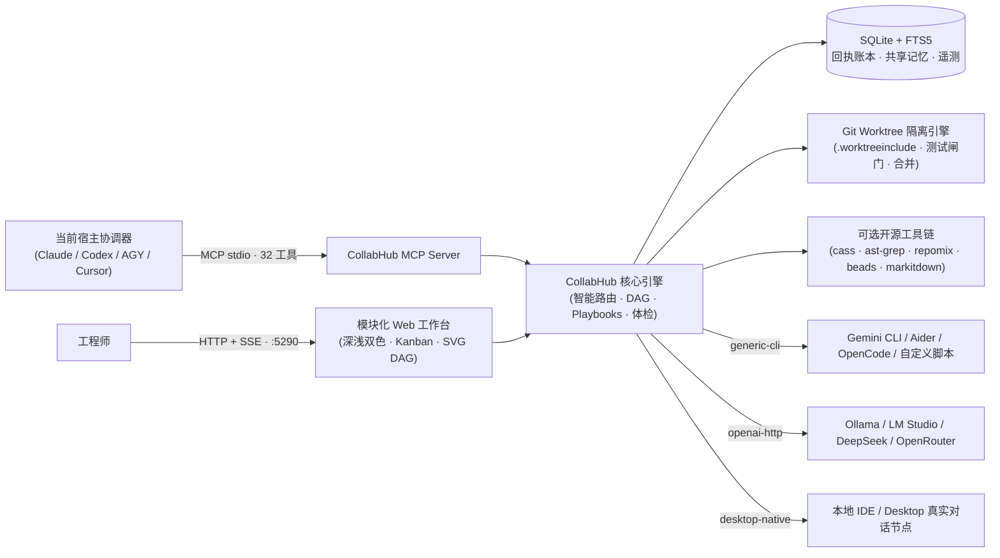

<div align="center">


<h3>把你已在使用的 AI 编程 Agent 统一到一个本地优先的 MCP 协作中枢 —— 真实回执账本、Git Worktree 测试闸门与可视化 SVG DAG，零 npm 运行时依赖。</h3>

<p>
  <a href="https://github.com/mortal7520/collab-hub/actions/workflows/ci.yml"></a>
  <a href="https://github.com/mortal7520/collab-hub/releases/latest"></a>
  <a href="https://github.com/mortal7520/collab-hub/stargazers"></a>
  <a href="LICENSE"></a>
  =22.13" />
  
  
</p>

<p>
  <a href="README.md">English</a> · <strong>简体中文</strong> · <a href="CHANGELOG.md">更新日志</a> · <a href="CONTRIBUTING.md">参与贡献</a>
</p>

</div>

---

- **零厂商锁定，复用你已有的 Agent** —— 通过 **32 个统一 MCP 工具** 和一个本地 Web 工作台，统一编排 Claude Code、Codex、Gemini CLI、Aider、OpenCode、Ollama、LM Studio、DeepSeek、OpenRouter 或自定义脚本。
- **拒绝盲合并与静默丢单** —— 每次派发都写入 SQLite 真实回执账本，附带 Token/耗时/成功率遥测、卡住检测、429 通道冷却，以及基于白名单测试验证闸门的 Git Worktree 并发隔离合并。
- **零 npm 第三方依赖，10 秒启动** —— 纯 Node.js `>=22.13` 原生内置模块（`node:sqlite`、`node:http`、`node:child_process`），开箱兼容 Windows、macOS 与 Linux。

<p align="center">
  
</p>

---

## 快速开始

### 1. 10 秒启动工作台（无需 `npm install`）

仅需 **Node.js `>=22.13.0`**（使用内置 `node:sqlite`）与 `git`：

```bash
git clone https://github.com/mortal7520/collab-hub.git
cd collab-hub
npm start
```

- **零隐私安全预览模式（纯内存示例数据，不读取本地库）**：打开 `http://127.0.0.1:5290/?demo=1`
- **真实本地工作台**：打开 `http://127.0.0.1:5290`
- 按 `Ctrl+K` / `Cmd+K` 随时呼出全局命令面板，点击右上角图标可切换 **Obsidian Dark（深色）** / **Alabaster Light（浅色）** 主题。

### 2. 接入任意 MCP 客户端

将 CollabHub 注册到 Claude Code、Codex、Antigravity、Cursor 或任何支持 MCP 的宿主中：

```json
{
  "mcpServers": {
    "collab-hub": {
      "command": "node",
      "args": ["/absolute/path/to/collab-hub/bin/collab-hub.mjs", "mcp"]
    }
  }
}
```

### 3. 自动发现本机 Agent 与运行测试

```bash
# 自动探测本机已安装的编程 CLI 与 OpenAI 兼容端点（Ollama、LM Studio 等）
node bin/collab-hub.mjs discover

# 运行完整自动化测试套件（26 项端到端测试，零外部依赖）
npm test
```

---

## 界面导览

### 账本表格 + 4 列 Kanban 看板与批次回执
在「排队/派发中」「执行中」「需关注/阻塞」「已结束」四条泳道中追踪所有委派任务；支持按 Agent、状态与批次筛选，点开侧抽屉核验完整回执并一键导出 Markdown 批次战报。

<p align="center">
  
</p>

### 实时可视化 SVG DAG 编排与四套实战流水线
自由编排多阶段依赖图，下游步骤自动注入上游输出，右侧 `Flow Canvas` 实时绘制节点、贝塞尔连线与环路告警；同时内置 4 套一键 Playbooks（`code-review-squad`、`research-and-pack`、`adversarial-debate`、`multi-agent-build`）。

<p align="center">
  
</p>

---

## 系统架构



---

## 客观竞品对比

CollabHub 与主流开源多 Agent 编程编排项目的核心差异：

| 维度 | **CollabHub** | **Vibe Kanban** | **Cline** | **Overstory** *(已归档)* | **OpenHands** |
| :--- | :---: | :---: | :---: | :---: | :---: |
| **核心形态** | 本地 MCP 中枢 + Web 工作台 | Kanban Web 应用 | IDE 插件 | CLI 编排器 + `ov serve` 界面 | 云端/容器化全托管平台 |
| **异构多 Agent 路由** | 内置（`auto` + 自动回退 + 429 冷却） | 单卡多 Agent | 单 IDE 循环 | CLI 多 Agent 蜂群 | 多 Agent SDK / Runtime |
| **可视化 SVG DAG 与 Playbooks** | 内置实时画布 + 4 套流水线 | Kanban 卡片流 | Workflows / Hooks | Sling / Mail 波次 | SDK 流水线 |
| **Git Worktree 与测试合并闸门** | 内置（SHA 测试闸门 + `.worktreeinclude`） | 内置 Worktree | 工作区直接修改 | 内置 Worktree | 容器沙箱 |
| **零 npm 运行时依赖** | **是**（`node:sqlite` + 原生内置模块） | 否（Rust/Node 栈） | 否（VS Code 插件） | 否（Bun/TS 栈） | 否（Python + Docker） |
| **托管云端 / SaaS 沙箱** | **否**（严格本地优先） | 可选 | 自备 API / 云端 | 否 | **是** |

> **哪些场景*不适合* CollabHub？** 如果你需要云端 SaaS 多人托管、容器化远程执行沙箱或嵌入单一编辑器的侧边栏补全，**OpenHands**、**Cline** 或 **Vibe Kanban** 会更契合。CollabHub 专为本地已运行多种编程 Agent/CLI 的工程师打造：轻量、可审计、零外部依赖，完整保留你原有的账号体系、权限边界与本地 Git 工作流。

---

## 可插拔 Agent 适配器

通过界面「`+ 扩展 Agent`」或 `collab_agent_register` 动态注册任意新成员（持久化到 `<dataDir>/agents.json`）：

| 适配器类型 | 典型示例 | 安全边界 |
| :--- | :--- | :--- |
| `generic-cli` | Gemini CLI、Aider、OpenCode、Qwen Code、自定义脚本 | 使用参数数组执行（`shell: false`），严格超时控制，输出自动落账 |
| `openai-http` | Ollama（`localhost:11434/v1`）、LM Studio、vLLM、DeepSeek、OpenRouter | **仅接受 `api_key_env` 环境变量名**，绝不存储或打印明文密钥 |
| `desktop-native` | 本地活跃 IDE / 桌面端 Agent 对话 | 仅登记真实协作回执，绝不伪造或静默用 CLI 替代桌面会话 |

---

## 32 个统一 MCP 工具一览

<details>
<summary><strong>点击展开全部 32 个 MCP 工具清单</strong></summary>

| 分类 | 工具列表 |
| :--- | :--- |
| **舰队与智能路由** | `collab_roster`, `collab_plan`, `collab_metrics`, `collab_cooldown` |
| **动态扩展注册表** | `collab_agent_discover`, `collab_agent_register`, `collab_agent_list`, `collab_agent_remove` |
| **派发与回执账本** | `collab_dispatch`, `collab_poll`, `collab_poll_batch`, `collab_task_reconcile`, `collab_record_handoff`, `collab_tasks`, `collab_batch_report` |
| **DAG、Playbooks 与模板** | `collab_workflow_run`, `collab_playbook_run`, `collab_recipes` |
| **Git Worktree 隔离与闸门** | `collab_worktree_create`, `collab_worktree_review`, `collab_worktree_verify`, `collab_worktree_merge`, `collab_worktree_cleanup` |
| **SQLite FTS5 共享记忆** | `collab_memory_write`, `collab_memory_search`, `collab_memory_list` |
| **可选开源工程工具链** | `collab_session_search` (`cass`), `collab_ast_search` (`ast-grep`), `collab_repo_pack` (`repomix`), `collab_beads` (`bd`), `collab_doc_to_md` (`markitdown`) |
| **运维体检与热备份** | `collab_doctor`（8 项系统体检 + SQLite `VACUUM INTO` 热备份） |

</details>

---

## 环境配置与数据目录

默认情况下，CollabHub 将所有运行时数据保存在系统标准用户目录（macOS/Linux 为 `~/.collab-hub`，Windows 为 `%LOCALAPPDATA%\CollabHub`），绝不污染你的 Git 仓库。

| 环境变量 | 默认值 | 说明 |
| :--- | :--- | :--- |
| `COLLAB_HUB_HOME` | `~/.collab-hub` / `%LOCALAPPDATA%\CollabHub` | 指定运行时根目录（`data/`、`backups/`、`logs/`、`worktrees/`） |
| `COLLAB_HUB_WORKSPACE` | 当前目录 | Worktree 与项目自动补全的默认工作区根目录 |
| `COLLAB_HUB_PORT` | `5290` | Web 工作台 HTTP + SSE 监听端口（严格绑定 `127.0.0.1`） |
| `COLLAB_HUB_MAIL_PORT` | `5291` | 可选 Agent Mail 顾问式文件锁服务端口 |

也可以在仓库根目录放置被 `.gitignore` 忽略的 `.collab-hub.local.json` 来固定本机 `appRoot` / `workspaceRoot`，不影响任何公开提交。

---

## 自举实践：用 CollabHub 自己构建 `v1.1.0`

本次 `v1.1.0` 大改版本身就是通过 CollabHub 多 Agent 协作流水线（`batch_id: v11_release_team`）完成的：
1. **前端工作台重构** —— 派发到独立 Git Worktree（`wt_v11_ui`）并行开发，经过 `collab_worktree_review` 审查与 `collab_worktree_verify` 测试闸门放行后通过 `collab_worktree_merge` 零冲突合入。
2. **对抗式安全与发布审计** —— 由独立审查 Agent 并行红队审计，补齐 CSP 安全头、`HEAD` 空响应体、`?demo=1` 数据库金丝雀隔离测试与合并闸门强校验。
3. **开源仓库展示优化** —— 由独立调研 Agent 对标竞品并给出文档精简、客观取舍与三图故事线建议，全部落地至本版本。

---

## 开源协议

MIT License — 详见 [LICENSE](LICENSE)。
